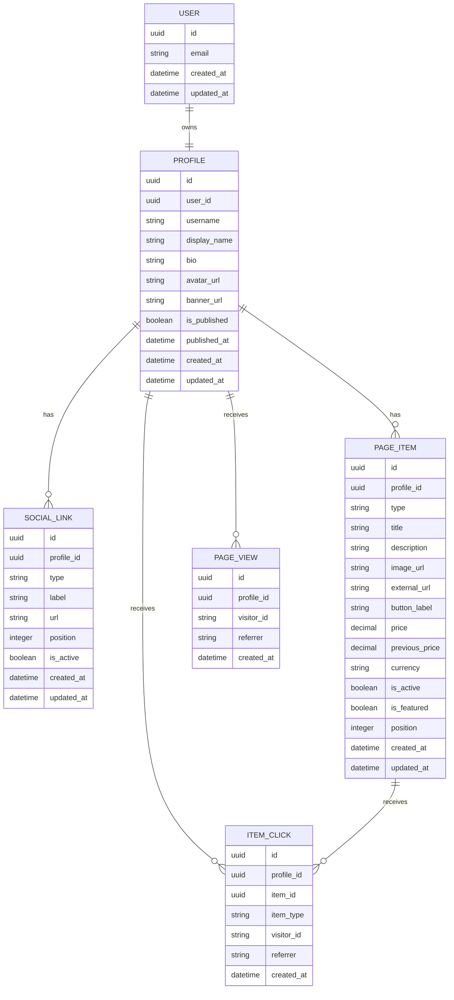

# Data Model

## Objetivo

Este documento descreve o modelo de dados necessário para o MVP.

O modelo deve suportar os seguintes fluxos:

- criação de conta;
- configuração da página pública;
- cadastro de redes sociais;
- cadastro de itens clicáveis da página pública;
- cadastro de produtos recomendados;
- cadastro de links manuais comuns;
- publicação da página;
- registro de visualizações;
- registro de cliques em itens.

O modelo inicial deve permanecer simples, evitando estruturas que ainda não são necessárias para validar o produto.

---

## Visão geral

As principais entidades do MVP são:

- `User`;
- `Profile`;
- `SocialLink`;
- `PageItem`;
- `PageView`;
- `ItemClick`.

`Product` e `ProductClick` não são entidades separadas no MVP. Produtos recomendados são representados por `PageItem` com `type = product`, e cliques em produtos ou links são registrados em `ItemClick`.

Relacionamentos principais:

```text
User
 └── Profile
      ├── SocialLinks
      ├── PageItems
      ├── PageViews
      └── ItemClicks
```

Um usuário possui uma página pública representada pelo perfil.

O perfil pode possuir várias redes sociais e vários itens de página.

`PageItem` é a entidade principal da área clicável da página pública. No MVP, os tipos permitidos são:

- `product`;
- `link`.

Produtos e links manuais são tipos equivalentes de conteúdo clicável para fins de publicação, ativação, destaque, ordenação, redirecionamento e métricas.

O modelo não deve tratar produto como entidade raiz. Produto é apenas uma variação de `PageItem`, identificada por `type = product`, com alguns campos opcionais específicos para exibição.

Um perfil pode publicar:

- apenas produtos;
- apenas links;
- produtos e links juntos.

`SocialLink` continua separado porque redes sociais fazem parte da identidade do criador e devem aparecer no topo, com comportamento visual próprio.

Visualizações e cliques são registrados para permitir métricas básicas.

---

# Entidades

## User

Representa a conta utilizada para autenticação e acesso à área privada.

### Campos

| Campo        | Tipo     | Obrigatório | Descrição                          |
| ------------ | -------- | ----------: | ---------------------------------- |
| `id`         | UUID     |         Sim | Identificador único do usuário     |
| `email`      | String   |         Sim | E-mail utilizado para autenticação |
| `created_at` | DateTime |         Sim | Data de criação da conta           |
| `updated_at` | DateTime |         Sim | Data da última atualização         |

### Regras

- o e-mail deve ser único;
- o e-mail não deve ser exibido publicamente;
- os dados de autenticação devem ser administrados pelo serviço de autenticação;
- um usuário pode possuir apenas um perfil no MVP.

### Observação

Senha, recuperação de senha, sessões e provedores sociais não precisam fazer parte diretamente do banco principal caso sejam administrados por um serviço externo de autenticação.

---

## Profile

Representa a página pública do criador e suas informações principais.

### Campos

| Campo          | Tipo     | Obrigatório | Descrição                             |
| -------------- | -------- | ----------: | ------------------------------------- |
| `id`           | UUID     |         Sim | Identificador único do perfil         |
| `user_id`      | UUID     |         Sim | Referência ao usuário proprietário    |
| `username`     | String   |         Sim | Nome único utilizado na URL pública   |
| `display_name` | String   |         Sim | Nome exibido na página                |
| `bio`          | String   |         Não | Apresentação curta do criador         |
| `avatar_url`   | String   |         Não | Endereço da foto de perfil            |
| `banner_url`   | String   |         Não | Endereço da imagem de capa            |
| `is_published` | Boolean  |         Sim | Define se a página está pública       |
| `published_at` | DateTime |         Não | Data da publicação mais recente        |
| `created_at`   | DateTime |         Sim | Data de criação                       |
| `updated_at`   | DateTime |         Sim | Data da última atualização            |

### Regras

- cada perfil pertence a um único usuário;
- cada usuário pode possuir apenas um perfil;
- o `username` deve ser único;
- o `username` deve ser tratado sem diferença entre letras maiúsculas e minúsculas;
- `is_published` é a fonte de verdade para saber se a página está acessível publicamente;
- somente perfis com `is_published = true` podem ser acessados por visitantes;
- `published_at` não deve ser usado sozinho para decidir visibilidade pública;
- `published_at = null` indica que o perfil nunca foi publicado;
- ao publicar pela primeira vez, preencher `published_at` com o momento atual;
- ao despublicar, manter `published_at` com o valor existente;
- ao republicar, atualizar `published_at` para o novo momento de publicação;
- histórico completo de publicações e despublicações fica fora do MVP;
- o perfil pode ser publicado mesmo sem itens ativos;
- quando não houver itens ativos, a página pública deve exibir as informações do criador e suas redes sociais.

### Regras sugeridas para username

O `username` deve:

- possuir entre 3 e 30 caracteres;
- aceitar letras minúsculas;
- aceitar números;
- aceitar hífen ou underscore, caso necessário;
- não conter espaços;
- não utilizar palavras reservadas.

Exemplos de palavras reservadas:

```text
admin
api
app
dashboard
login
logout
signup
register
settings
support
help
about
privacy
terms
```

### Exemplo

```json
{
  "id": "profile-uuid",
  "user_id": "user-uuid",
  "username": "lucasreviews",
  "display_name": "Lucas Reviews",
  "bio": "Produtos, ferramentas e links que uso e recomendo.",
  "avatar_url": "https://example.com/avatar.jpg",
  "banner_url": null,
  "is_published": true
}
```

---

## SocialLink

Representa uma rede social ou link de presença digital exibido no topo do perfil.

### Campos

| Campo        | Tipo           | Obrigatório | Descrição                     |
| ------------ | -------------- | ----------: | ----------------------------- |
| `id`         | UUID           |         Sim | Identificador único           |
| `profile_id` | UUID           |         Sim | Perfil proprietário           |
| `type`       | Enum ou String |         Sim | Tipo do link social           |
| `label`      | String         |         Não | Nome personalizado            |
| `url`        | String         |         Sim | Endereço externo              |
| `position`   | Integer        |         Sim | Ordem de exibição             |
| `is_active`  | Boolean        |         Sim | Define se o link será exibido |
| `created_at` | DateTime       |         Sim | Data de criação               |
| `updated_at` | DateTime       |         Sim | Data da última atualização    |

### Tipos iniciais

```text
instagram
tiktok
youtube
whatsapp
website
other
```

### Regras

- cada link social pertence a um único perfil;
- somente links sociais ativos devem aparecer publicamente;
- a URL deve ser válida;
- a posição deve ser utilizada para ordenar os links;
- o campo `label` pode ser obrigatório quando o tipo for `other`;
- redes sociais não entram na lista principal de `PageItem`;
- cliques em redes sociais podem ser medidos futuramente, mas não fazem parte das métricas de item do MVP.

### Exemplo

```json
{
  "id": "social-link-uuid",
  "profile_id": "profile-uuid",
  "type": "instagram",
  "label": null,
  "url": "https://instagram.com/lucasreviews",
  "position": 1,
  "is_active": true
}
```

---

## PageItem

Representa um conteúdo clicável exibido na área principal da página pública.

No MVP, `PageItem` substitui a ideia de uma lista composta apenas por produtos. A mesma entidade será usada para:

- produtos recomendados (`type = product`);
- links manuais comuns (`type = link`).

Essa modelagem permite ordenar produtos e links em uma lista única, registrar cliques de forma uniforme e manter a página pública flexível sem criar um e-commerce, marketplace ou rede social.

### Campos

| Campo            | Tipo           | Obrigatório | Descrição                                      |
| ---------------- | -------------- | ----------: | ---------------------------------------------- |
| `id`             | UUID           |         Sim | Identificador único                            |
| `profile_id`     | UUID           |         Sim | Perfil proprietário                            |
| `type`           | Enum ou String |         Sim | Tipo do item: `product` ou `link`              |
| `title`          | String         |         Sim | Nome do produto ou título do link              |
| `description`    | String         |         Não | Descrição curta                                |
| `image_url`      | String         |         Não | Imagem opcional, usada inicialmente em produto |
| `external_url`   | String         |         Sim | Destino externo                                |
| `button_label`   | String         |         Não | Texto exibido no botão                         |
| `price`          | Decimal        |         Não | Preço informativo, apenas para produto         |
| `previous_price` | Decimal        |         Não | Preço anterior opcional, apenas para produto   |
| `currency`       | String         |         Não | Moeda utilizada no preço do produto            |
| `is_active`      | Boolean        |         Sim | Define se o item aparece publicamente          |
| `is_featured`    | Boolean        |         Sim | Define se o item está em destaque              |
| `position`       | Integer        |         Sim | Ordem de exibição                              |
| `created_at`     | DateTime       |         Sim | Data de criação                                |
| `updated_at`     | DateTime       |         Sim | Data da última atualização                     |

### Tipos iniciais

```text
product
link
```

### Regras gerais

- cada item pertence a um único perfil;
- o tipo é obrigatório;
- o título é obrigatório;
- o destino externo é obrigatório;
- somente itens ativos aparecem na página pública;
- itens inativos continuam disponíveis no painel;
- a posição será utilizada para definir a ordem dos itens ativos e inativos no painel;
- produtos e links devem compartilhar a mesma lista e a mesma regra de ordenação;
- produtos e links devem compartilhar o mesmo fluxo de clique e redirecionamento;
- a compra, inscrição, leitura, download ou qualquer outra ação final sempre acontecerá fora da plataforma;
- a plataforma não deve criar carrinho, checkout, pagamentos, pedidos, estoque, entrega, comentários ou feed social.

### Campos específicos por tipo

Os campos comuns a qualquer `PageItem` são:

- `id`;
- `profile_id`;
- `type`;
- `title`;
- `description`;
- `external_url`;
- `button_label`;
- `is_active`;
- `is_featured`;
- `position`;
- `created_at`;
- `updated_at`.

Campos usados por produtos:

- `image_url`;
- `price`;
- `previous_price`;
- `currency`.

Campos usados por links:

- `title`;
- `description`;
- `external_url`;
- `button_label`;
- `position`;
- `is_active`;
- `is_featured`.

No MVP, links manuais não devem depender de imagem, preço ou moeda. Um link deve ser suficiente com título, URL externa, posição e status ativo/inativo.

### Regras para `type = product`

- representa um produto recomendado pelo criador;
- pode possuir imagem, descrição, preço, preço anterior e moeda;
- deve usar `external_url` para o link afiliado, loja externa ou página externa do produto;
- o preço é apenas informativo;
- o preço não será atualizado automaticamente no MVP;
- se `previous_price` for informado, deve ser maior que `price`, quando essa comparação for possível;
- pode ser marcado como destaque;
- cada perfil poderá possuir no máximo um item em destaque no MVP.

### Regras para `type = link`

- representa um link manual comum que não é produto;
- deve possuir título e URL externa;
- pode possuir descrição curta e texto de botão;
- deve possuir posição para ordenação junto aos demais itens;
- pode ser ativado ou desativado sem ser excluído;
- pode ser marcado como destaque;
- não deve usar preço, preço anterior ou moeda;
- não deve exigir imagem no MVP;
- não deve ser usado para redes sociais que pertencem ao topo do perfil;
- pode aparecer junto aos produtos na lista principal;
- pode ser o único tipo de item ativo em uma página publicada;
- não deve transformar a página em uma rede social, e-commerce ou marketplace.

### Evoluções futuras previstas

Alguns formatos podem ser úteis depois, mas não devem adicionar complexidade ao MVP:

- imagem específica para links manuais;
- vídeo anexado ou incorporado a um item;
- miniatura de vídeo;
- detecção automática de metadados da URL.

No MVP, produtos podem usar `image_url`. Links simples devem funcionar bem apenas com título, URL, descrição opcional, texto de botão opcional, status ativo/inativo e posição.

Se imagem de link ou vídeo forem adicionados futuramente, devem ser tratados como extensão de `PageItem` ou como metadados opcionais, sem transformar a plataforma em feed social, hospedagem de vídeo ou CMS genérico.

### Item em destaque

No MVP, cada perfil poderá possuir no máximo um item em destaque.

O destaque pode ser aplicado a qualquer `PageItem` ativo, seja produto ou link, quando fizer sentido para o criador. A interface deve deixar claro o tipo do item destacado.

Ao marcar um novo item como destaque, a plataforma deve remover o destaque do item anterior.

Alternativamente, essa regra pode ser garantida pela aplicação no primeiro momento e reforçada no banco posteriormente.

Um item inativo não deve aparecer como destaque na página pública. Ao desativar um item destacado, a aplicação deve remover seu destaque ou ignorá-lo nas consultas públicas.

### Publicação, ativação e visibilidade

A visibilidade pública depende de duas regras independentes:

- o perfil precisa estar publicado;
- o item precisa estar ativo.

Um `PageItem` só aparece para visitantes quando:

```text
Profile.is_published = true
PageItem.is_active = true
```

Itens inativos:

- não aparecem publicamente;
- continuam visíveis e editáveis no painel privado;
- continuam podendo manter histórico de cliques anteriores;
- não devem ser contabilizados como itens públicos ativos;
- não devem ser retornados em consultas públicas, exceto em rotas internas autorizadas.

Perfis despublicados:

- não exibem itens, mesmo que eles estejam ativos;
- devem mostrar uma página indisponível ou estado equivalente para visitantes;
- continuam disponíveis para edição pelo proprietário.

### Ordenação

`position` define a ordem da lista principal de `PageItem`.

Regras:

- a ordenação deve ser aplicada dentro do mesmo `profile_id`;
- produtos e links participam da mesma sequência;
- a consulta pública deve ordenar por `position` de forma crescente;
- empates de posição devem ter desempate estável, por exemplo `created_at` ou `id`;
- o item em destaque pode ser exibido visualmente antes da lista, mas continua sendo um `PageItem` comum;
- se o destaque for renderizado separado da lista, a interface deve evitar duplicar o mesmo item.

No painel privado, itens ativos e inativos podem compartilhar a mesma ordenação para simplificar reordenação.

### Texto padrão do botão

Caso `button_label` não seja informado:

- para `type = product`, utilizar `Ver produto`;
- para `type = link`, utilizar `Acessar link`.

### Moeda padrão

Caso um preço seja informado em um item de produto sem moeda, utilizar:

```text
BRL
```

### Exemplo de produto

```json
{
  "id": "item-product-uuid",
  "profile_id": "profile-uuid",
  "type": "product",
  "title": "Fone Bluetooth",
  "description": "Modelo que utilizo no dia a dia.",
  "image_url": "https://example.com/product.jpg",
  "external_url": "https://loja.com/produto?affiliate=123",
  "button_label": "Ver oferta",
  "price": 149.9,
  "previous_price": 199.9,
  "currency": "BRL",
  "is_active": true,
  "is_featured": false,
  "position": 2
}
```

### Exemplo de link manual

```json
{
  "id": "item-link-uuid",
  "profile_id": "profile-uuid",
  "type": "link",
  "title": "Lista completa de equipamentos",
  "description": "Planilha com meus acessórios favoritos.",
  "image_url": null,
  "external_url": "https://example.com/equipamentos",
  "button_label": "Abrir lista",
  "price": null,
  "previous_price": null,
  "currency": null,
  "is_active": true,
  "is_featured": false,
  "position": 3
}
```

---

## Visitor ID anônimo

O MVP deve usar um identificador anônimo de visitante para analytics básico.

Esse identificador deve ser gerado pela própria aplicação e salvo em um cookie first-party. O valor deve ser aleatório, preferencialmente um UUID ou identificador equivalente com entropia suficiente.

O cookie deve conter apenas esse valor aleatório. Ele não deve conter:

- e-mail;
- nome;
- username;
- endereço IP;
- user-agent completo;
- qualquer outro dado pessoal direto.

`visitor_id` pode ser reutilizado em `PageView` e `ItemClick` para estimativas simples de visitantes recorrentes.

O identificador é opcional. Se a aplicação não conseguir criar, salvar ou ler o cookie, visualizações e cliques ainda podem ser registrados com:

```text
visitor_id = null
```

A ausência de `visitor_id` não deve bloquear o tracking básico nem impedir o redirecionamento de um clique.

Endereço IP não deve ser armazenado diretamente no banco no MVP.

User-agent completo não deve ser armazenado no MVP.

O cookie existe apenas para analytics básico. Ele não deve ser usado para autenticação, fingerprinting, rastreamento avançado, identificação cross-site, origem detalhada, localização ou inferência de dispositivo.

Analytics avançado, fingerprinting, origem detalhada, localização, dispositivo e identificação cross-site ficam fora do MVP.

---

## PageView

Representa uma visualização da página pública.

### Campos

| Campo        | Tipo     | Obrigatório | Descrição                          |
| ------------ | -------- | ----------: | ---------------------------------- |
| `id`         | UUID     |         Sim | Identificador único                |
| `profile_id` | UUID     |         Sim | Perfil visualizado                 |
| `visitor_id` | String   |         Não | Identificador anônimo do visitante |
| `referrer`   | String   |         Não | Origem informada pelo navegador    |
| `created_at` | DateTime |         Sim | Data e hora da visualização        |

### Regras

- a visualização deve estar relacionada ao perfil acessado;
- visitantes não precisam possuir conta;
- não armazenar informações pessoais desnecessárias;
- `visitor_id` deve ser anônimo, gerado pela aplicação e salvo em cookie first-party;
- `visitor_id` deve conter apenas um valor aleatório, como UUID, sem dados pessoais diretos;
- `visitor_id` é opcional e pode ser registrado como `null` quando o cookie não puder ser criado ou lido;
- falha ao criar ou ler o cookie não deve impedir o registro da visualização;
- endereços IP não devem ser armazenados diretamente no banco no MVP;
- user-agent completo não deve ser armazenado no MVP;
- métricas do MVP podem ser acumuladas sem análises avançadas.

### Contagem inicial

No primeiro corte, a aplicação pode registrar uma visualização por carregamento da página.

Posteriormente, pode ser criada uma regra para reduzir duplicações do mesmo visitante em um período curto.

### Exemplo

```json
{
  "id": "page-view-uuid",
  "profile_id": "profile-uuid",
  "visitor_id": "anonymous-session-id",
  "referrer": "https://www.instagram.com/",
  "created_at": "2026-08-04T18:00:00Z"
}
```

---

## ItemClick

Representa um clique realizado por um visitante em um item da página pública.

### Campos

| Campo        | Tipo     | Obrigatório | Descrição                          |
| ------------ | -------- | ----------: | ---------------------------------- |
| `id`         | UUID     |         Sim | Identificador único                |
| `profile_id` | UUID     |         Sim | Perfil proprietário do item        |
| `item_id`    | UUID     |         Sim | Item clicado                       |
| `item_type`  | String   |         Sim | Tipo do item no momento do clique  |
| `visitor_id` | String   |         Não | Identificador anônimo do visitante |
| `referrer`   | String   |         Não | Origem informada pelo navegador    |
| `created_at` | DateTime |         Sim | Data e hora do clique              |

### Regras

- o clique deve estar relacionado ao item;
- o item deve pertencer ao perfil informado;
- o tipo do item deve ser armazenado para facilitar métricas básicas por tipo;
- o clique deve ser registrado antes do redirecionamento;
- a falha no registro não deve impedir o redirecionamento;
- o visitante não precisa estar autenticado;
- `visitor_id` deve ser anônimo, gerado pela aplicação e salvo em cookie first-party;
- `visitor_id` deve conter apenas um valor aleatório, como UUID, sem dados pessoais diretos;
- `visitor_id` é opcional e pode ser registrado como `null` quando o cookie não puder ser criado ou lido;
- falha ao criar ou ler o cookie não deve impedir o registro do clique nem o redirecionamento;
- endereços IP não devem ser armazenados diretamente no banco no MVP;
- user-agent completo não deve ser armazenado no MVP;
- não armazenar dados pessoais desnecessários.

### Analytics por item

`ItemClick` é a fonte primária para analytics de qualquer `PageItem`.

As métricas por item devem funcionar da mesma forma para produtos e links:

- total de cliques por `item_id`;
- total de cliques por `item_id` em um período;
- total de cliques por `item_type`;
- ranking de itens mais clicados;
- taxa estimada de clique do item em relação às visualizações do perfil.

O campo `item_type` registra o tipo do item no momento do clique. Isso evita depender apenas do estado atual do item caso ele seja alterado depois.

No MVP, não é necessário armazenar impressões individuais por item. `PageView` mede visualizações da página como um todo.

### Exemplo

```json
{
  "id": "item-click-uuid",
  "profile_id": "profile-uuid",
  "item_id": "item-product-uuid",
  "item_type": "product",
  "visitor_id": "anonymous-session-id",
  "referrer": "https://www.tiktok.com/",
  "created_at": "2026-08-04T18:05:00Z"
}
```

---

# Relacionamentos

## User e Profile

```text
User 1 ─── 1 Profile
```

- um usuário possui um perfil;
- um perfil pertence a um usuário.

## Profile e SocialLink

```text
Profile 1 ─── N SocialLink
```

- um perfil pode possuir vários links sociais;
- um link social pertence a um perfil.

## Profile e PageItem

```text
Profile 1 ─── N PageItem
```

- um perfil pode possuir vários itens;
- um item pertence a um perfil.

## Profile e PageView

```text
Profile 1 ─── N PageView
```

- um perfil pode receber várias visualizações;
- uma visualização pertence a um perfil.

## Profile e ItemClick

```text
Profile 1 ─── N ItemClick
```

- um perfil pode receber vários cliques;
- um clique pertence a um perfil.

## PageItem e ItemClick

```text
PageItem 1 ─── N ItemClick
```

- um item pode receber vários cliques;
- um clique está relacionado a um item.

---

# Diagrama simplificado



---

# Restrições e índices

## Restrições únicas

Devem ser únicos:

- `User.email`;
- `Profile.user_id`;
- `Profile.username`.

Também deve existir uma garantia para permitir no máximo um destaque por perfil:

- no banco, preferencialmente índice único parcial para `PageItem.profile_id` quando `is_featured = true`;
- na aplicação, ao marcar um item como destaque, remover o destaque anterior do mesmo perfil na mesma operação lógica.

Para validar cliques com consistência, pode existir uma restrição única composta em `PageItem`:

- `PageItem.profile_id + PageItem.id`.

## Chaves estrangeiras

Devem existir referências entre:

- `Profile.user_id` e `User.id`;
- `SocialLink.profile_id` e `Profile.id`;
- `PageItem.profile_id` e `Profile.id`;
- `PageView.profile_id` e `Profile.id`;
- `ItemClick.profile_id` e `Profile.id`;
- `ItemClick.item_id` e `PageItem.id`.

`ItemClick` deve garantir que `item_id` pertence ao mesmo `profile_id` registrado no clique. Essa garantia pode ser feita por chave estrangeira composta referenciando uma combinação única equivalente em `PageItem`.

## Índices recomendados

Criar índices para:

- `Profile.username`;
- `Profile.is_published`;
- `SocialLink.profile_id`;
- `SocialLink.profile_id + is_active + position`;
- `PageItem.profile_id`;
- `PageItem.profile_id + type`;
- `PageItem.profile_id + is_active`;
- `PageItem.profile_id + is_active + position`;
- `PageItem.profile_id + is_active + is_featured`;
- `PageItem.profile_id + is_featured`;
- `PageView.profile_id`;
- `PageView.profile_id + created_at`;
- `ItemClick.profile_id`;
- `ItemClick.item_id`;
- `ItemClick.item_id + created_at`;
- `ItemClick.profile_id + item_id`;
- `ItemClick.profile_id + item_type`.

Esses índices ajudam a carregar páginas públicas, ordenar a lista principal, localizar o item em destaque e calcular métricas básicas por item, tipo e período.

Consultas públicas esperadas:

- buscar `Profile` por `username` quando `is_published = true`;
- buscar `SocialLink` por `profile_id`, `is_active = true`, ordenado por `position`;
- buscar `PageItem` por `profile_id`, `is_active = true`, ordenado por `position`;
- buscar o `PageItem` destacado ativo por `profile_id`.

Consultas privadas esperadas:

- listar todos os `PageItem` de um perfil, ativos e inativos;
- filtrar itens por `type`;
- alternar `is_active`;
- alterar `position`;
- consultar cliques por `item_id`.

---

# Exclusão de dados

## Exclusão do perfil

Ao excluir um perfil, os seguintes dados relacionados devem ser removidos ou anonimizados:

- redes sociais;
- itens da página;
- visualizações;
- cliques.

A exclusão da conta deve ser tratada com cuidado para evitar registros órfãos.

## Exclusão de item

No primeiro corte do MVP, a ação padrão para remover um `PageItem` da página pública não é exclusão definitiva.

O caminho padrão é desativar o item:

```text
PageItem.is_active = false
```

Ao desativar um item:

- o item deixa de aparecer na página pública;
- o item continua visível no painel privado;
- o item continua editável;
- o item pode ser reativado posteriormente;
- os registros de `ItemClick` existentes permanecem preservados;
- o analytics básico por item continua disponível com base no histórico de cliques.

Excluir definitivamente um `PageItem` fica fora do primeiro corte do MVP.

Se a exclusão definitiva for adicionada futuramente, uma decisão específica deve definir o comportamento dos registros de `ItemClick`, escolhendo explicitamente entre remover em cascade, anonimizar, preservar como histórico ou consolidar em métricas agregadas.

O fluxo padrão do MVP não deve apagar `ItemClick` ao remover um item da página pública.

## Exclusão lógica

No MVP, itens devem utilizar `is_active` para ocultação da página pública.

Não introduzir `deleted_at` no MVP, salvo se houver justificativa explícita registrada em `docs/decisions.md`.

A exclusão lógica pode ser implementada futuramente caso exista necessidade de recuperação ou auditoria.

---

# Armazenamento de imagens

As imagens não devem ser armazenadas diretamente no banco de dados.

O banco deverá guardar apenas a URL ou o caminho do arquivo.

Tipos de imagem:

- avatar do perfil;
- banner do perfil;
- imagem de item, principalmente produto no MVP.

A aplicação deve validar:

- formato;
- tamanho;
- proporção quando necessário;
- propriedade do arquivo;
- acesso permitido.

---

# Segurança e autorização

## Dados privados

Somente o proprietário do perfil pode:

- editar suas informações;
- adicionar ou remover redes sociais;
- cadastrar itens;
- editar itens;
- ativar ou desativar itens;
- publicar ou despublicar a página;
- consultar métricas privadas.

## Dados públicos

Visitantes podem consultar apenas:

- perfis publicados;
- informações públicas do criador;
- redes sociais ativas;
- itens ativos.

## Isolamento de dados

Toda operação privada deve validar que:

```text
recurso.profile_id pertence ao usuário autenticado
```

Não é suficiente confiar em um identificador enviado pelo frontend.

A autorização deve ser garantida no servidor ou no banco de dados.

---

# Validações principais

## Profile

- `username` válido e disponível;
- `display_name` não vazio;
- biografia limitada a um tamanho razoável;
- URLs de imagens válidas;
- publicação permitida somente com dados mínimos;
- `published_at` deve ser preenchido ao publicar pela primeira vez;
- `published_at` deve ser mantido ao despublicar;
- `published_at` deve ser atualizado ao republicar;
- `is_published` deve ser usado como fonte de verdade para visibilidade pública.

## SocialLink

- tipo válido;
- URL válida;
- posição maior ou igual a zero;
- label obrigatória para links personalizados.

## PageItem

- tipo válido: `product` ou `link`;
- título não vazio;
- link externo válido;
- `external_url` deve usar protocolo permitido, como `https://` ou `http://`;
- posição maior ou igual a zero;
- no máximo um item em destaque por perfil;
- destaque permitido para produtos e links;
- item destacado deve pertencer ao mesmo perfil;
- item destacado exibido publicamente deve estar ativo;
- itens do tipo `link` não devem usar preço, preço anterior ou moeda;
- itens do tipo `link` não devem exigir imagem ou vídeo no MVP;
- itens do tipo `product` podem usar preço, preço anterior, moeda, imagem e descrição;
- preço e preço anterior devem ser valores não negativos;
- se `previous_price` e `price` forem informados para produto, `previous_price` deve ser maior que `price`;
- moeda deve usar código ISO 4217 quando informada, com `BRL` como padrão inicial para produtos com preço;
- campos específicos de produto devem ser nulos ou ignorados quando `type = link`.

---

# Dados derivados

Algumas informações não precisam ser armazenadas diretamente.

## Quantidade de itens

Pode ser calculada a partir dos itens pertencentes ao perfil.

## Quantidade de produtos

Pode ser calculada filtrando:

```text
profile_id = perfil atual
type = product
```

## Quantidade de links manuais

Pode ser calculada filtrando:

```text
profile_id = perfil atual
type = link
```

## Quantidade de itens ativos

Pode ser calculada filtrando:

```text
profile_id = perfil atual
is_active = true
```

## Total de visualizações

Pode ser calculado pela quantidade de registros em `PageView`.

## Total de cliques

Pode ser calculado pela quantidade de registros em `ItemClick`.

## Total de cliques por item

Pode ser calculado agrupando os cliques por `item_id`.

Essa é a métrica principal para performance individual de qualquer `PageItem`, independentemente de ser produto ou link.

## Total de cliques por tipo

Pode ser calculado agrupando os cliques por `item_type`.

Essa métrica permite comparar desempenho agregado entre:

- produtos;
- links manuais.

## Taxa de clique por item

Pode ser calculada combinando:

```text
cliques do item / visualizações do perfil
```

No MVP, essa taxa deve ser tratada como estimativa simples, porque `PageView` mede visualizações do perfil inteiro, não impressões individuais de cada item.

## Ranking de itens

Pode ser calculado ordenando `PageItem` por total de cliques em `ItemClick`.

Esse ranking deve incluir produtos e links de forma equivalente.

No MVP, essas consultas são suficientes.

Caso o volume cresça, poderão ser criados contadores agregados ou tabelas de métricas.

Contadores derivados, se adicionados futuramente, devem ser tratados como cache de analytics e não como fonte primária do clique. A fonte primária continua sendo `ItemClick`.

---

# Decisões do MVP

## Uma página por usuário

Cada usuário terá apenas uma página pública.

Múltiplas páginas por conta ficam fora do MVP.

## Itens de página com tipos

Produtos recomendados e links manuais comuns serão representados por `PageItem`.

A lista principal da página pública será ordenada por `position` e exibirá apenas itens ativos.

## Produtos e links são formatos equivalentes

Produtos recomendados e links manuais comuns são formatos válidos de `PageItem`.

A página pública deve funcionar com apenas produtos, apenas links ou produtos e links juntos.

Produtos podem ter campos específicos, como preço e imagem. Links manuais devem continuar simples e não substituem `SocialLink`.

## Redes sociais separadas

`SocialLink` continua separado de `PageItem`.

Redes sociais pertencem ao topo do perfil e ajudam a apresentar a identidade do criador.

## Itens sem categorias

Os itens serão exibidos em uma lista única.

A organização será feita por:

- item em destaque;
- posição de exibição;
- status ativo ou inativo.

Categorias poderão ser adicionadas depois, caso os usuários cadastrem muitos itens.

## Cadastro manual

Todos os produtos e links serão cadastrados manualmente.

Não haverá importação ou sincronização automática no MVP.

## Preço informativo

O preço exibido será informado pelo criador e deve ser usado apenas em itens do tipo `product`.

A plataforma não garante que ele seja igual ao preço encontrado na loja externa.

## Redirecionamento externo

A plataforma registra o clique e redireciona o visitante.

Ela não participa da compra, do pagamento, do pedido, da entrega, do estoque ou da execução do serviço externo.

## Métricas simples

Serão registrados apenas:

- visualizações de página;
- cliques em itens.

Não haverá analytics avançado na primeira versão.

---

# Itens não modelados

Não fazem parte do modelo inicial:

- carrinho;
- checkout;
- pedidos;
- pagamentos;
- estoque;
- frete;
- entrega;
- avaliações;
- comentários;
- seguidores;
- feed social;
- categorias;
- coleções;
- múltiplas páginas por usuário;
- permissões por equipe;
- importação automática;
- sincronização com marketplaces;
- analytics avançado.
