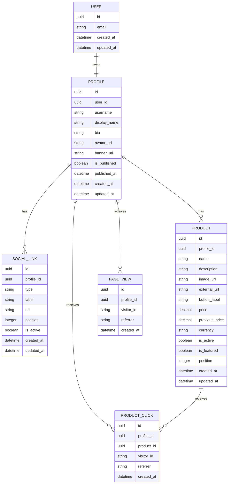

# Data Model

## Objetivo

Este documento descreve o modelo de dados necessário para o MVP.

O modelo deve suportar os seguintes fluxos:

- criação de conta;
- configuração da página pública;
- cadastro de redes sociais;
- cadastro de produtos;
- publicação da página;
- registro de visualizações;
- registro de cliques em produtos.

O modelo inicial deve permanecer simples, evitando estruturas que ainda não são necessárias para validar o produto.

---

## Visão geral

As principais entidades do MVP são:

- `User`;
- `Profile`;
- `SocialLink`;
- `Product`;
- `PageView`;
- `ProductClick`.

Relacionamentos principais:

```text
User
 └── Profile
      ├── SocialLinks
      ├── Products
      ├── PageViews
      └── ProductClicks
```

Um usuário possui uma página pública representada pelo perfil.

O perfil pode possuir várias redes sociais e vários produtos.

Visualizações e cliques são registrados para permitir métricas básicas.

---

# Entidades

## User

Representa a conta utilizada para autenticação e acesso à área privada.

### Campos

| Campo        | Tipo     | Obrigatório | Descrição                          |
| ------------ | -------- | ----------: | ---------------------------------- |
| `id`         | UUID     |         Sim | Identificador único do usuário     |
| `email`      | String   |         Sim | E-mail utilizado para autenticação |
| `created_at` | DateTime |         Sim | Data de criação da conta           |
| `updated_at` | DateTime |         Sim | Data da última atualização         |

### Regras

- o e-mail deve ser único;
- o e-mail não deve ser exibido publicamente;
- os dados de autenticação devem ser administrados pelo serviço de autenticação;
- um usuário pode possuir apenas um perfil no MVP.

### Observação

Senha, recuperação de senha, sessões e provedores sociais não precisam fazer parte diretamente do banco principal caso sejam administrados por um serviço externo de autenticação.

---

## Profile

Representa a página pública do criador e suas informações principais.

### Campos

| Campo          | Tipo     | Obrigatório | Descrição                             |
| -------------- | -------- | ----------: | ------------------------------------- |
| `id`           | UUID     |         Sim | Identificador único do perfil         |
| `user_id`      | UUID     |         Sim | Referência ao usuário proprietário    |
| `username`     | String   |         Sim | Nome único utilizado na URL pública   |
| `display_name` | String   |         Sim | Nome exibido na página                |
| `bio`          | String   |         Não | Apresentação curta do criador         |
| `avatar_url`   | String   |         Não | Endereço da foto de perfil            |
| `banner_url`   | String   |         Não | Endereço da imagem de capa            |
| `is_published` | Boolean  |         Sim | Define se a página está pública       |
| `published_at` | DateTime |         Não | Data da primeira ou última publicação |
| `created_at`   | DateTime |         Sim | Data de criação                       |
| `updated_at`   | DateTime |         Sim | Data da última atualização            |

### Regras

- cada perfil pertence a um único usuário;
- cada usuário pode possuir apenas um perfil;
- o `username` deve ser único;
- o `username` deve ser tratado sem diferença entre letras maiúsculas e minúsculas;
- somente perfis publicados podem ser acessados por visitantes;
- o perfil pode ser publicado mesmo sem produtos ativos;
- quando não houver produtos ativos, a página pública deve exibir as informações do criador e suas redes sociais.

### Regras sugeridas para username

O `username` deve:

- possuir entre 3 e 30 caracteres;
- aceitar letras minúsculas;
- aceitar números;
- aceitar hífen ou underscore, caso necessário;
- não conter espaços;
- não utilizar palavras reservadas.

Exemplos de palavras reservadas:

```text
admin
api
app
dashboard
login
logout
signup
register
settings
support
help
about
privacy
terms
```

### Exemplo

```json
{
  "id": "profile-uuid",
  "user_id": "user-uuid",
  "username": "lucasreviews",
  "display_name": "Lucas Reviews",
  "bio": "Produtos e acessórios que uso e recomendo.",
  "avatar_url": "https://example.com/avatar.jpg",
  "banner_url": null,
  "is_published": true
}
```

---

## SocialLink

Representa uma rede social ou link externo exibido no perfil.

### Campos

| Campo        | Tipo           | Obrigatório | Descrição                     |
| ------------ | -------------- | ----------: | ----------------------------- |
| `id`         | UUID           |         Sim | Identificador único           |
| `profile_id` | UUID           |         Sim | Perfil proprietário           |
| `type`       | Enum ou String |         Sim | Tipo do link                  |
| `label`      | String         |         Não | Nome personalizado            |
| `url`        | String         |         Sim | Endereço externo              |
| `position`   | Integer        |         Sim | Ordem de exibição             |
| `is_active`  | Boolean        |         Sim | Define se o link será exibido |
| `created_at` | DateTime       |         Sim | Data de criação               |
| `updated_at` | DateTime       |         Sim | Data da última atualização    |

### Tipos iniciais

```text
instagram
tiktok
youtube
whatsapp
website
other
```

### Regras

- cada link pertence a um único perfil;
- somente links ativos devem aparecer publicamente;
- a URL deve ser válida;
- a posição deve ser utilizada para ordenar os links;
- o campo `label` pode ser obrigatório quando o tipo for `other`.

### Exemplo

```json
{
  "id": "social-link-uuid",
  "profile_id": "profile-uuid",
  "type": "instagram",
  "label": null,
  "url": "https://instagram.com/lucasreviews",
  "position": 1,
  "is_active": true
}
```

---

## Product

Representa um produto recomendado pelo criador.

### Campos

| Campo            | Tipo     | Obrigatório | Descrição                                |
| ---------------- | -------- | ----------: | ---------------------------------------- |
| `id`             | UUID     |         Sim | Identificador único                      |
| `profile_id`     | UUID     |         Sim | Perfil proprietário                      |
| `name`           | String   |         Sim | Nome do produto                          |
| `description`    | String   |         Não | Descrição curta                          |
| `image_url`      | String   |         Não | Endereço da imagem                       |
| `external_url`   | String   |         Sim | Link afiliado ou link externo            |
| `button_label`   | String   |         Não | Texto exibido no botão                   |
| `price`          | Decimal  |         Não | Preço informado manualmente              |
| `previous_price` | Decimal  |         Não | Preço anterior opcional                  |
| `currency`       | String   |         Não | Moeda utilizada no preço                 |
| `is_active`      | Boolean  |         Sim | Define se o produto aparece publicamente |
| `is_featured`    | Boolean  |         Sim | Define se o produto está em destaque     |
| `position`       | Integer  |         Sim | Ordem de exibição                        |
| `created_at`     | DateTime |         Sim | Data de criação                          |
| `updated_at`     | DateTime |         Sim | Data da última atualização               |

### Regras

- cada produto pertence a um único perfil;
- o nome é obrigatório;
- o link externo é obrigatório;
- somente produtos ativos aparecem na página pública;
- produtos inativos continuam disponíveis no painel;
- o preço é apenas informativo;
- o preço não será atualizado automaticamente no MVP;
- a compra sempre acontecerá em um serviço externo;
- a posição será utilizada para definir a ordem dos produtos.

### Produto em destaque

No MVP, cada perfil poderá possuir no máximo um produto em destaque.

Ao marcar um novo produto como destaque, a plataforma deve remover o destaque do produto anterior.

Alternativamente, essa regra pode ser garantida pela aplicação no primeiro momento e reforçada no banco posteriormente.

### Texto padrão do botão

Caso `button_label` não seja informado, utilizar:

```text
Ver produto
```

### Moeda padrão

Caso um preço seja informado sem moeda, utilizar:

```text
BRL
```

### Exemplo

```json
{
  "id": "product-uuid",
  "profile_id": "profile-uuid",
  "name": "Fone Bluetooth",
  "description": "Modelo que utilizo no dia a dia.",
  "image_url": "https://example.com/product.jpg",
  "external_url": "https://loja.com/produto?affiliate=123",
  "button_label": "Ver oferta",
  "price": 149.9,
  "previous_price": 199.9,
  "currency": "BRL",
  "is_active": true,
  "is_featured": false,
  "position": 2
}
```

---

## PageView

Representa uma visualização da página pública.

### Campos

| Campo        | Tipo     | Obrigatório | Descrição                          |
| ------------ | -------- | ----------: | ---------------------------------- |
| `id`         | UUID     |         Sim | Identificador único                |
| `profile_id` | UUID     |         Sim | Perfil visualizado                 |
| `visitor_id` | String   |         Não | Identificador anônimo do visitante |
| `referrer`   | String   |         Não | Origem informada pelo navegador    |
| `created_at` | DateTime |         Sim | Data e hora da visualização        |

### Regras

- a visualização deve estar relacionada ao perfil acessado;
- visitantes não precisam possuir conta;
- não armazenar informações pessoais desnecessárias;
- o identificador do visitante deve ser anônimo;
- endereços IP não devem ser armazenados diretamente sem necessidade;
- métricas do MVP podem ser acumuladas sem análises avançadas.

### Contagem inicial

No primeiro corte, a aplicação pode registrar uma visualização por carregamento da página.

Posteriormente, pode ser criada uma regra para reduzir duplicações do mesmo visitante em um período curto.

### Exemplo

```json
{
  "id": "page-view-uuid",
  "profile_id": "profile-uuid",
  "visitor_id": "anonymous-session-id",
  "referrer": "https://www.instagram.com/",
  "created_at": "2026-08-04T18:00:00Z"
}
```

---

## ProductClick

Representa um clique realizado por um visitante em um produto.

### Campos

| Campo        | Tipo     | Obrigatório | Descrição                          |
| ------------ | -------- | ----------: | ---------------------------------- |
| `id`         | UUID     |         Sim | Identificador único                |
| `profile_id` | UUID     |         Sim | Perfil proprietário do produto     |
| `product_id` | UUID     |         Sim | Produto clicado                    |
| `visitor_id` | String   |         Não | Identificador anônimo do visitante |
| `referrer`   | String   |         Não | Origem informada pelo navegador    |
| `created_at` | DateTime |         Sim | Data e hora do clique              |

### Regras

- o clique deve estar relacionado ao produto;
- o produto deve pertencer ao perfil informado;
- o clique deve ser registrado antes do redirecionamento;
- a falha no registro não deve impedir o redirecionamento;
- o visitante não precisa estar autenticado;
- não armazenar dados pessoais desnecessários.

### Exemplo

```json
{
  "id": "product-click-uuid",
  "profile_id": "profile-uuid",
  "product_id": "product-uuid",
  "visitor_id": "anonymous-session-id",
  "referrer": "https://www.tiktok.com/",
  "created_at": "2026-08-04T18:05:00Z"
}
```

---

# Relacionamentos

## User e Profile

```text
User 1 ─── 1 Profile
```

- um usuário possui um perfil;
- um perfil pertence a um usuário.

## Profile e SocialLink

```text
Profile 1 ─── N SocialLink
```

- um perfil pode possuir vários links sociais;
- um link social pertence a um perfil.

## Profile e Product

```text
Profile 1 ─── N Product
```

- um perfil pode possuir vários produtos;
- um produto pertence a um perfil.

## Profile e PageView

```text
Profile 1 ─── N PageView
```

- um perfil pode receber várias visualizações;
- uma visualização pertence a um perfil.

## Profile e ProductClick

```text
Profile 1 ─── N ProductClick
```

- um perfil pode receber vários cliques;
- um clique pertence a um perfil.

## Product e ProductClick

```text
Product 1 ─── N ProductClick
```

- um produto pode receber vários cliques;
- um clique está relacionado a um produto.

---

# Diagrama simplificado



---

# Restrições e índices

## Restrições únicas

Devem ser únicos:

- `User.email`;
- `Profile.user_id`;
- `Profile.username`.

## Chaves estrangeiras

Devem existir referências entre:

- `Profile.user_id` e `User.id`;
- `SocialLink.profile_id` e `Profile.id`;
- `Product.profile_id` e `Profile.id`;
- `PageView.profile_id` e `Profile.id`;
- `ProductClick.profile_id` e `Profile.id`;
- `ProductClick.product_id` e `Product.id`.

## Índices recomendados

Criar índices para:

- `Profile.username`;
- `SocialLink.profile_id`;
- `SocialLink.profile_id + position`;
- `Product.profile_id`;
- `Product.profile_id + is_active`;
- `Product.profile_id + position`;
- `PageView.profile_id`;
- `PageView.profile_id + created_at`;
- `ProductClick.profile_id`;
- `ProductClick.product_id`;
- `ProductClick.product_id + created_at`.

Esses índices ajudam a carregar páginas públicas e calcular métricas básicas.

---

# Exclusão de dados

## Exclusão do perfil

Ao excluir um perfil, os seguintes dados relacionados devem ser removidos ou anonimizados:

- redes sociais;
- produtos;
- visualizações;
- cliques.

A exclusão da conta deve ser tratada com cuidado para evitar registros órfãos.

## Exclusão de produto

Ao excluir um produto, existem duas opções:

1. remover também seus registros de clique;
2. preservar os cliques para histórico, removendo apenas a referência pública.

Para o MVP, a opção mais simples é impedir a exclusão imediata e recomendar que o usuário desative o produto.

Caso a exclusão definitiva seja permitida, os cliques podem ser removidos junto com o produto.

## Exclusão lógica

No MVP, produtos podem utilizar `is_active` para ocultação.

Não é necessário adicionar `deleted_at` inicialmente.

A exclusão lógica pode ser implementada futuramente caso exista necessidade de recuperação ou auditoria.

---

# Armazenamento de imagens

As imagens não devem ser armazenadas diretamente no banco de dados.

O banco deverá guardar apenas a URL ou o caminho do arquivo.

Tipos de imagem:

- avatar do perfil;
- banner do perfil;
- imagem do produto.

A aplicação deve validar:

- formato;
- tamanho;
- proporção quando necessário;
- propriedade do arquivo;
- acesso permitido.

---

# Segurança e autorização

## Dados privados

Somente o proprietário do perfil pode:

- editar suas informações;
- adicionar ou remover redes sociais;
- cadastrar produtos;
- editar produtos;
- ativar ou desativar produtos;
- publicar ou despublicar a página;
- consultar métricas privadas.

## Dados públicos

Visitantes podem consultar apenas:

- perfis publicados;
- informações públicas do criador;
- redes sociais ativas;
- produtos ativos.

## Isolamento de dados

Toda operação privada deve validar que:

```text
recurso.profile_id pertence ao usuário autenticado
```

Não é suficiente confiar em um identificador enviado pelo frontend.

A autorização deve ser garantida no servidor ou no banco de dados.

---

# Validações principais

## Profile

- `username` válido e disponível;
- `display_name` não vazio;
- biografia limitada a um tamanho razoável;
- URLs de imagens válidas;
- publicação permitida somente com dados mínimos.

## SocialLink

- tipo válido;
- URL válida;
- posição maior ou igual a zero;
- label obrigatória para links personalizados.

## Product

- nome não vazio;
- link externo válido;
- preço não negativo;
- preço anterior não negativo;
- posição maior ou igual a zero;
- no máximo um produto em destaque por perfil.

---

# Dados derivados

Algumas informações não precisam ser armazenadas diretamente.

## Quantidade de produtos

Pode ser calculada a partir dos produtos pertencentes ao perfil.

## Quantidade de produtos ativos

Pode ser calculada filtrando:

```text
profile_id = perfil atual
is_active = true
```

## Total de visualizações

Pode ser calculado pela quantidade de registros em `PageView`.

## Total de cliques

Pode ser calculado pela quantidade de registros em `ProductClick`.

## Total de cliques por produto

Pode ser calculado agrupando os cliques por `product_id`.

No MVP, essas consultas são suficientes.

Caso o volume cresça, poderão ser criados contadores agregados ou tabelas de métricas.

---

# Decisões do MVP

## Uma página por usuário

Cada usuário terá apenas uma página pública.

Múltiplas páginas por conta ficam fora do MVP.

## Produtos sem categorias

Os produtos serão exibidos em uma lista única.

A organização será feita por:

- produto em destaque;
- posição de exibição;
- status ativo ou inativo.

Categorias poderão ser adicionadas depois, caso os usuários cadastrem muitos produtos.

## Cadastro manual

Todos os produtos serão cadastrados manualmente.

Não haverá importação ou sincronização automática no MVP.

## Preço informativo

O preço exibido será informado pelo criador.

A plataforma não garante que ele seja igual ao preço encontrado na loja externa.

## Redirecionamento externo

A plataforma registra o clique e redireciona o visitante.

Ela não participa da compra, do pagamento, do pedido, da entrega ou do estoque.

## Métricas simples

Serão registrados apenas:

- visualizações de página;
- cliques em produtos.

Não haverá analytics avançado na primeira versão.

---

# Itens não modelados

Os seguintes conceitos não fazem parte do produto ou do MVP atual:

- carrinho;
- checkout;
- pagamentos;
- pedidos;
- estoque;
- frete;
- entregas;
- devoluções;
- notas fiscais;
- categorias;
- avaliações;
- comentários;
- seguidores;
- favoritos;
- chat;
- campanhas;
- cupons internos;
- comissões processadas pela plataforma;
- múltiplos administradores;
- planos e assinaturas.

Essas entidades não devem ser criadas antecipadamente.

---

# Possíveis evoluções

Após a validação do MVP, o modelo poderá receber novas entidades relacionadas a:

- categorias ou coleções;
- temas personalizados;
- domínios próprios;
- importação de produtos;
- integrações externas;
- cupons externos;
- métricas agregadas;
- planos de assinatura;
- páginas para marcas.

Essas estruturas somente devem ser adicionadas quando houver necessidade real.

---

# Resumo

O modelo inicial é composto por uma conta, um perfil público, redes sociais, produtos e eventos básicos de visualização e clique.

A estrutura atende ao fluxo principal do produto:

```text
Usuário cria conta
        ↓
Configura perfil
        ↓
Cadastra produtos
        ↓
Publica a página
        ↓
Visitante acessa
        ↓
Visitante clica
        ↓
Plataforma registra e redireciona
```

O modelo não inclui funcionalidades de comércio eletrônico, pois a plataforma será permanentemente uma vitrine de links externos.
